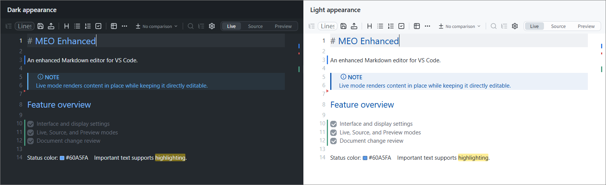
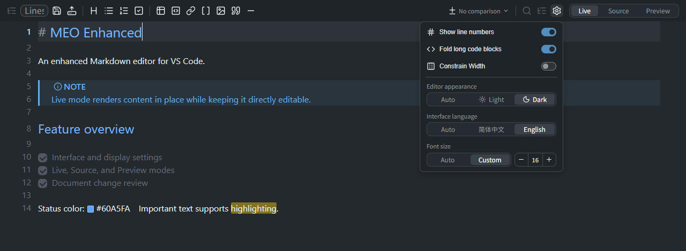
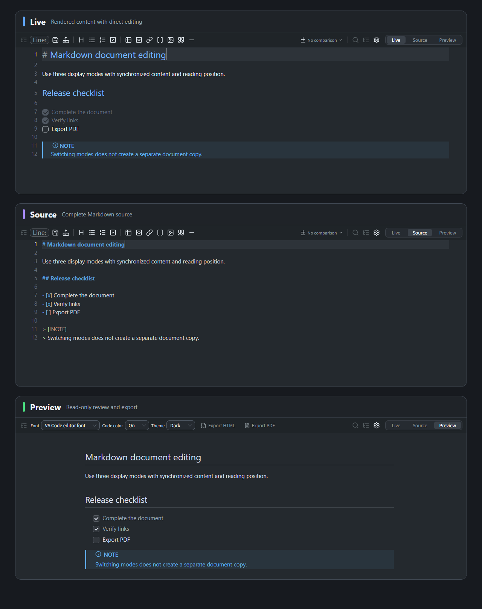
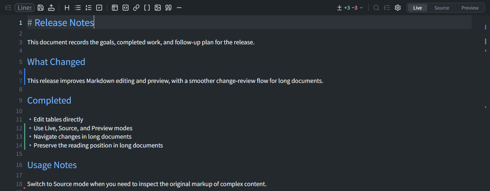
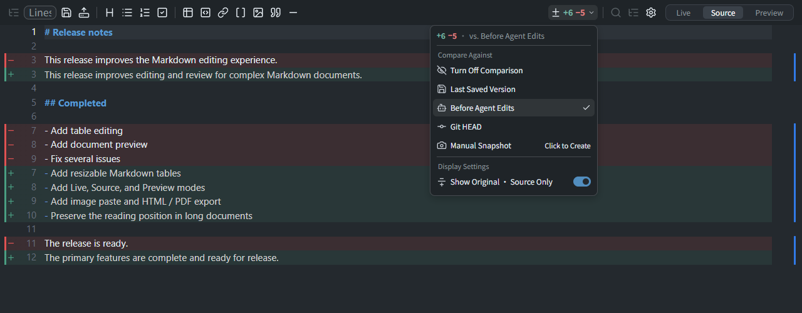
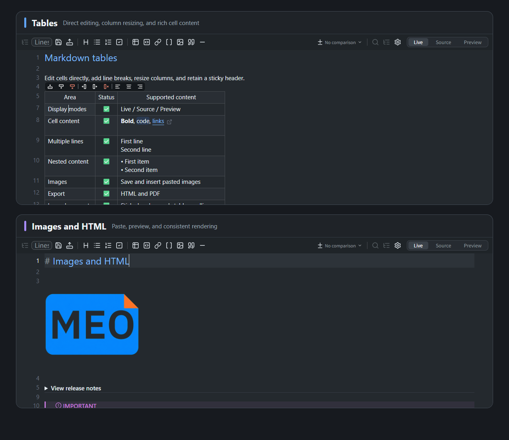
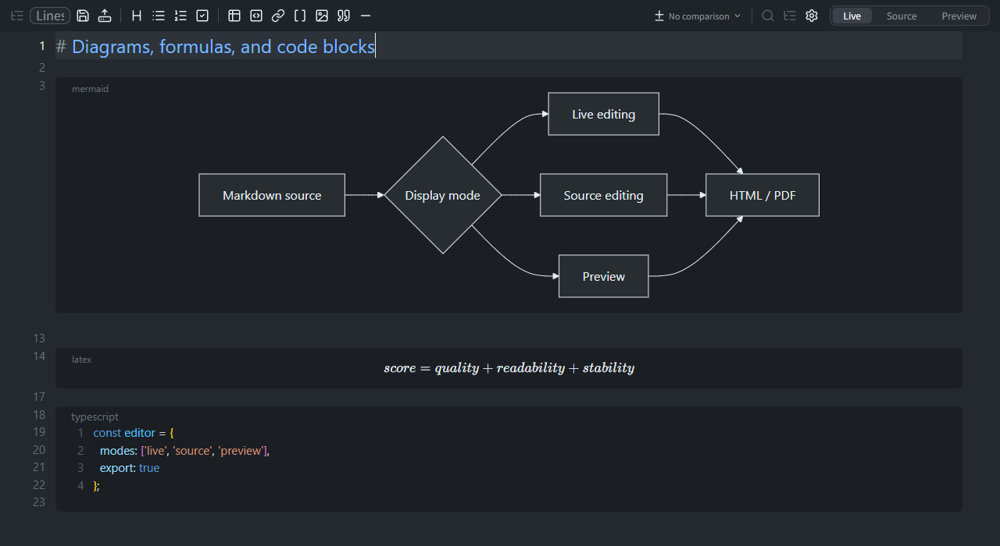

# MEO Enhanced

Write, preview, and review complex Markdown seamlessly in VS Code, switch freely between Live, Source, and Preview modes, and handle tables, Mermaid, LaTeX, HTML, and more with ease.

在 VS Code 中流畅编写、预览和审阅复杂 Markdown，随时切换实时、源码与预览模式，并轻松处理表格、Mermaid、LaTeX、HTML 等内容。

<p align="center">
  <strong>English</strong> · <a href="https://github.com/huangko555/meo-enhanced/blob/main/README.zh-CN.md">简体中文</a> · <a href="https://github.com/huangko555/meo-enhanced/blob/main/CONTRIBUTING.md">Contributing</a>
</p>

<p align="center">
  <a href="https://marketplace.visualstudio.com/items?itemName=huangko555.meo-enhanced"><strong>Install from VS Code Marketplace</strong></a> ·
  <a href="https://github.com/huangko555/meo-enhanced/releases">Download VSIX</a> ·
  <a href="https://github.com/huangko555/meo-enhanced/blob/main/CHANGELOG.md">Changelog</a>
</p>



MEO Enhanced is designed for users who write and review complex Markdown documents in VS Code. It brings Markdown source, rendered output, and version differences into one interface, reducing the need to switch between separate editors and preview windows.

## Interface and display settings

The toolbar and its settings panel provide the following options:

- **Interface language**: Simplified Chinese, English, or the current VS Code display language.
- **Editor appearance**: Light, Dark, or the current VS Code theme.
- **Content font size**: Follow the VS Code editor font size or use a custom size from `10` to `32`.
- **Document typography**: Adjust font size and line spacing in More Settings > Appearance. Line spacing defaults to `1.5×`; changes save automatically.
- **Preview settings**: Choose a preset and adjust its supported appearance, font, and code-coloring options.



## Three display modes

- **Live**: Displays rendered headings, lists, tables, images, diagrams, formulas, and other content in place while retaining direct editing.
- **Source**: Displays the complete Markdown source with syntax highlighting for precise markup changes, bulk editing, and inspection of the original content.
- **Preview**: Displays the fully rendered document in a read-only view, with preset and export controls.

All three modes use the same document content. The current reading position is preserved when switching modes, without creating or maintaining a separate preview document.



## Preview presets and export

Preview includes **Default**, which follows editor colors, and **GitHub README**, which provides a local GitHub-style preview. GitHub and custom presets use their own light/dark palettes.

Choose **Custom presets…** at the bottom of the preset menu to import and manage your presets. The [creation guide and examples](https://github.com/huangko555/meo-enhanced/blob/main/preview-presets/README.md) are provided separately on GitHub.

**Export as…** offers these formats, each with an optional table of contents:

| Format | Purpose and style |
| --- | --- |
| HTML | Browser reading, using the current preview preset and colors |
| PDF | Sharing and printing, using the preset with paginated layout |
| Word (.docx) | Further editing, using a fixed document format |

Exporting from preset settings shares the preset files.

## Document change review

Change review updates in real time as you edit, displaying additions, modifications, and deletions beside the editor and summarizing their counts in the toolbar. The overview ruler on the right shows how changes are distributed throughout the document, making them easy to locate in long files.



The following comparison baselines are available:

- **Last Saved Version**: Recommended for manual editing. Compares the current content with the most recent content saved to disk.
- **Before Agent Edits**: Recommended for agent editing. Shows changes produced by consecutive writes to disk.
- **Git HEAD**: Compares the current document with its version in the latest Git commit.
- **Manual Snapshot**: Captures the current document state and compares subsequent changes against it.

> **How does “Before Agent Edits” work?**
>
> Agent changes are written directly to disk, so they do not appear as unsaved content. This option therefore compares the current content with the preceding version saved to disk, showing the difference between two disk saves.
>
> Consecutive disk writes within 10 seconds are treated as one editing round and continue to use the version from before the first write in that round as the comparison baseline.
>
> If no preceding saved version is available, the most recently saved version is used as the baseline.

Source mode can display the previous content above modified lines. Consecutive content such as code blocks, tables, Mermaid diagrams, and formulas is grouped under the corresponding change marker so that each change can be reviewed in context.



## Markdown content support

### Tables

Markdown tables are displayed as interactive tables with support for:

- Direct cell editing.
- Adding or deleting rows and columns, and setting column alignment.
- Dragging to resize columns and retaining widths for the current session.
- Selecting and copying across multiple cells.
- Links, images, lists, code, and multiline content inside cells.
- A sticky header and editing toolbar for long tables.

### Images and HTML

Images can use local paths, workspace-relative paths, Windows absolute paths, or remote URLs. Configure pasted images in **Settings → Input → Paste → Image save location**: beside the document, beside the document by file name, or a custom path (advanced). Each choice expands its own path controls when selected. The fixed ./ prefix starts in the current Markdown directory; no workspace is required. Image names default to the document name plus a sequence number; date/time, image numbers and millisecond timestamps are also available, with a full-path example. Valid changes save automatically and existing images stay in place. See [image folder and naming settings](docs/image-storage.md).

Supported safe inline and block HTML renders in Live and Preview. In Live, click an HTML block to edit its syntax-colored source in place; visible output is previewed below the source. Standalone fragments with no visible output remain discoverable as faint source text. The format action preserves protected content and can be undone. HTML and PDF exports use the supported rendered output.



### Mermaid, LaTeX, and code blocks

Mermaid diagrams provide **Source**, **Split**, and **Preview** display options, with zoom, fullscreen viewing, and image/source copying.

Click a block LaTeX formula to edit its syntax-colored source in the main document, with a live preview below. Completion suggestions include formula previews. Select-all and layout-formatting buttons appear while the source is shown. Larger diagrams and formulas adapt to the available Preview and export area.

Code blocks support syntax highlighting, select all, copy, and folding for long code. Preview and exported documents can retain syntax colors.



### Other Markdown content

- Frontmatter Properties and source editing for complex YAML content.
- GitHub Alerts, footnotes, task lists, and blockquotes.
- Standard links, document anchors, and Wiki links, including `![[image.png]]`, `![[image.png|300]]`, and `![[image.png|300x200]]`.
- `==highlights==`, keyboard keys, color previews, and inline styles.
- Visual actions for merge conflict blocks.

Wiki references use the containing Obsidian vault, or the current workspace as a fallback. Explicit relative paths, vault paths, and unique short filenames are supported; duplicate names require a more specific path. Escape the size separator in tables, for example `![[image.png\|300]]`. Default Preview and exports support this syntax; the GitHub README preset keeps GitHub Markdown semantics.

### Settings and typing assistance

Open **More settings** from the settings menu to adjust typing assistance and shortcuts. See the [settings and clipboard guide](docs/editing-preferences.md) for input rules, table paste behavior and shortcut conflicts.

On Windows, pressing left Alt alone while editing in Live or Source keeps the caret in the document. Open the VS Code menu with the mouse; Alt combinations keep their existing behavior.

## Install

Install **MEO Enhanced - Markdown Editor** from the [VS Code Marketplace](https://marketplace.visualstudio.com/items?itemName=huangko555.meo-enhanced), or run:

```shell
code --install-extension huangko555.meo-enhanced
```

After installation, open any `.md`, `.markdown`, `.mdx`, or `.mdc` file directly. You can also right-click a file and select **Open With MEO Enhanced**. When another Markdown editor is installed, use VS Code's **Open With... → Configure Default Editor** command to choose your preference. An extension that rewrites editor associations on startup can still override that choice until it is disabled or fixed.

For offline installation, download a `.vsix` package from [GitHub Releases](https://github.com/huangko555/meo-enhanced/releases), then run **Extensions: Install from VSIX...** in VS Code.

## Compatibility

- Requires VS Code `1.94.0` or newer.
- Supports `.md`, `.markdown`, `.mdx`, and `.mdc` files.
- Can be installed alongside the original MEO extension; each extension uses independent editors, commands, and settings.

## Project origin

MEO Enhanced is based on [Markdown Editor Optimized (MEO)](https://github.com/vadimmelnicuk/meo). Editing is powered by [CodeMirror](https://codemirror.net/), with interaction design inspired by [Obsidian](https://obsidian.md/).

## License

[MIT License](LICENSE)
